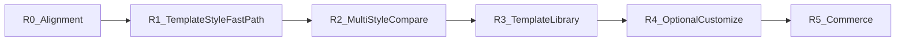

# ROADMAP

Product direction: **Template × Style → Preview → Dual Prompt (Agent + Constructor, RU+EN) → Export** ([PRODUCT.md](PRODUCT.md), [ADR-0009](decisions/ADR-0009-template-style-preview-prompt.md), [ADR-0011](decisions/ADR-0011-dual-prompt-surfaces.md)).

Atlas is a design-system library + prompt bridge — **not** a page constructor. Users build elsewhere (Cursor / Tilda-class tools).

Prior encyclopedia / “study design” UX is retired as the primary path.

## R0 — Product Direction Alignment (docs)

- [x] Rewrite PRODUCT / philosophy / AGENTS mission
- [x] ADR-0009 (Template / Style / Preview / Prompt / Export)
- [x] ADR-0010 (language policy)
- [x] ARCHITECTURE + ROADMAP rewrite
- [x] CONTENT_MODEL + spec pointers
- [x] Related inspiration: designprompts.dev, wangpf1129/design-prompts
- **No application code rewrite in R0**

## R1 — Template × Style Fast Path

- [x] Minimal `content/templates/` (`saas-landing`)
- [x] UI `/studio`: pick template + style → Live Preview
- [x] CTA: copy prompts (**RU + EN**) + Download Free Pack
- [x] Home + nav → Studio; Playground = “QA Playground”
- [ ] Extra templates (store, portfolio) — R3
- No customizer, no payments in R1

## R2 — Multi-style compare

- [x] Several styles on the **same** template (Same Content, Different Looks)
- [x] Published originals: `swiss-international`, `midnight-console`, `poster-brutal`
- [x] Studio compare rail (palette swatches → switch style, shared `saas-landing` copy)

## R2.5 — Dual handoff + SaaS landing fidelity

- [x] PRODUCT + ADR-0011: Agent + Constructor prompts (RU+EN); Atlas ≠ constructor
- [x] `saas-landing` preview chrome: nav, dual CTA, product media frame, form CTA
- [x] Studio actions: Агент / Конструктор; Free pack includes constructor prompts

## R2.6 — Studio UX foundation

- [x] Product nav + home copy aligned to ESSENCE; Lucide + hints
- [x] Prompt modal with visible text (Agent / Constructor × RU/EN)
- [x] Studio IA: tabs **Шаблон** | **Стиль** + system summary + tweak scaffold (disabled until R4)
- No new styles; no block-builder

## R2.7 — Prompt composer v1

Research freeze: [competitive-prompt-landscape-2026-11-10](research/competitive-prompt-landscape-2026-11-10.md).

- [x] Assemble Agent prompt: Role + style prompt + template section outline + optional product brief + handoff checklist
- [x] Modal: outline jump chips + character estimate
- [x] Explicit “build elsewhere” (no Shipper-like host; no block Builder; no site scrape)
- Out: MCP, live tweaks, mass styles

## R3 — Template library

- [x] `product-catalog` — store / product cards
- [x] `corporate-blog` — company site + news/blog strip
- [x] Prompt modal polish: clear **текст для ИИ** vs **ZIP файлы**
- [ ] More templates as needed (`portfolio`, …)
- Migrate remaining style-bound `demo.json` into templates over time
- Reuse richer landing chrome from R2.5

## R4 — Optional Style Customizer (Система)

Source map: [research/dizain-prompty-system-import-2026-11-09.md](./research/dizain-prompty-system-import-2026-11-09.md).

- [x] Live System drawer: **Accent / Font / Radius / Container** → preview CSS vars + composed prompt appendix
- [x] Token richness for complex packs: optional `accentSecondary`, `shadowInset`, `blur` (Neu / Clay / Glass)
- [x] Proof styles from owned catalog: `claymorphism`, `neumorphism`, `glassmorphism`, `neon-tech`
- Not in R4: block builder, freeform grid editor, persisting tweaks into Git content

## Approved style authoring queue (locked 2026-11-09)

One pack at a time: research → tokens → dual prompts → commit → rebuild. Adapt visual systems for Atlas web DS — do not copy InfoStyle marketplace image-gen prompts.

**Done:** `swiss-international`, `midnight-console`, `poster-brutal`, `claymorphism`, `neumorphism`, `glassmorphism`, `neon-tech`

| # | Atlas `id` | Source | Status |
|---|------------|--------|--------|
| 1 | `streetwear` | InfoStyle `market` | done |
| 2 | `blueprint-grid` | InfoStyle `blueprint` | done |
| 3 | `warm-premium` | InfoStyle `premium` | done |
| 4 | `soft-editorial` | InfoStyle `catalog` | done |
| 5 | `clinical-minimal` | InfoStyle `clinical` | done |
| 6 | `eco-botanical` | InfoStyle `eco` | done |
| 7 | `vintage-gold` | InfoStyle `vintage` | done |
| 8 | `industrial-power` | InfoStyle `industrial` | done — `dense-tile` + `gap: 0px` |
| 9 | `scandi-calm` | InfoStyle `scandi` | done |
| 10 | `neo-brutalism` | dizain-prompty | next (≠ `poster-brutal`; dense optional) |
| 11 | `aurora-mesh` | dizain-prompty | queued |
| 12 | `y2k` | dizain-prompty | queued |
| 13 | `retro-terminal` | dizain-prompty | queued |
| 14 | `bento-grid` | dizain-prompty | queued (atmosphere only; no Studio grid editor; may use dense-tile) |

**Dense tile (locked approach):** optional `spacing.gap` + composition `dense-tile` — not a global 0px default. Proof on `blueprint-grid`; soft-volume / premium styles keep air. Details: [research/dense-tile-gap.md](./research/dense-tile-gap.md).

## R5 — Commerce / Pro

- Paid Style Packs / library access
- **No payment provider until a dedicated decision**

## Out of scope until explicit ticket

- Auth, billing, MCP server, mass style generation via AI
- Expanding PHASE 7 Full Pack commerce UI before R1

## Legacy note

Older P0–P5 roadmap items are historical; foundation work (DS shell, content engine, swiss published, export) is **kept** as assets under the new R-track.
