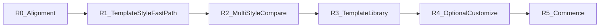

# ROADMAP

Product direction: **Template × Style → Preview → Dual Prompt (Agent + Constructor, RU+EN) → Export** ([PRODUCT.md](PRODUCT.md), [ADR-0009](decisions/ADR-0009-template-style-preview-prompt.md), [ADR-0011](decisions/ADR-0011-dual-prompt-surfaces.md)).

Atlas is a design-system library + prompt bridge — **not** a page constructor. Users build elsewhere (Cursor / Tilda-class tools).

Prior encyclopedia / “study design” UX is retired as the primary path.

## R0 — Product Direction Alignment (docs)

- [x] Rewrite PRODUCT / philosophy / AGENTS mission
- [x] ADR-0009 (Template / Style / Preview / Prompt / Export)
- [x] ADR-0010 (language policy)
- [x] ARCHITECTURE + ROADMAP rewrite
- [x] CONTENT_MODEL + spec pointers
- [x] Related inspiration: designprompts.dev, wangpf1129/design-prompts
- **No application code rewrite in R0**

## R1 — Template × Style Fast Path

- [x] Minimal `content/templates/` (`saas-landing`)
- [x] UI `/studio`: pick template + style → Live Preview
- [x] CTA: copy prompts (**RU + EN**) + Download Free Pack
- [x] Home + nav → Studio; Playground = “QA Playground”
- [ ] Extra templates (store, portfolio) — R3
- No customizer, no payments in R1

## R2 — Multi-style compare

- [x] Several styles on the **same** template (Same Content, Different Looks)
- [x] Published originals: `swiss-international`, `midnight-console`, `poster-brutal`
- [x] Studio compare rail (palette swatches → switch style, shared `saas-landing` copy)

## R2.5 — Dual handoff + SaaS landing fidelity

- [x] PRODUCT + ADR-0011: Agent + Constructor prompts (RU+EN); Atlas ≠ constructor
- [x] `saas-landing` preview chrome: nav, dual CTA, product media frame, form CTA
- [x] Studio actions: Агент / Конструктор; Free pack includes constructor prompts

## R2.6 — Studio UX foundation

- [x] Product nav + home copy aligned to ESSENCE; Lucide + hints
- [x] Prompt modal with visible text (Agent / Constructor × RU/EN)
- [x] Studio IA: tabs **Шаблон** | **Стиль** + system summary + tweak scaffold (disabled until R4)
- No new styles; no block-builder

## R3 — Template library

- `online-store`, `portfolio`, …
- Migrate style-bound `demo.json` into templates + renderer
- Reuse richer landing chrome from R2.5

## R4 — Optional Style Customizer

- Minimal: color / accent / font family only

## R5 — Commerce / Pro

- Paid Style Packs / library access
- **No payment provider until a dedicated decision**

## Out of scope until explicit ticket

- Auth, billing, MCP server, mass style generation via AI
- Expanding PHASE 7 Full Pack commerce UI before R1

## Legacy note

Older P0–P5 roadmap items are historical; foundation work (DS shell, content engine, swiss published, export) is **kept** as assets under the new R-track.
