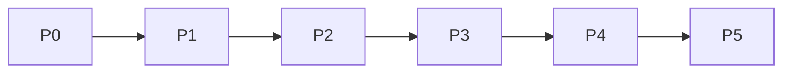

# ROADMAP

Приоритеты **P0–P5**. Текущая работа: **P0** (завершение foundation docs) → вход в **P1**.

## P0 — Foundation (текущая)

**Цель:** единый источник истины для людей и агентов без продуктовых фич.

- [x] Каркас Next.js, TS strict, Tailwind, Zod, Vitest deps
- [x] Документация `docs/`, ADR 0001–0007, шаблоны
- [x] Placeholder `content/`, `design/`
- [ ] `vitest.config`, scripts `typecheck`/`test`, CI workflow (следующий PR)
- [ ] Базовые Zod-схемы в `src/lib/schemas/` (зеркало DATA_CONTRACTS)

**Не делаем:** публичные страницы стилей, playground, наполнение каталога.

## P1 — App design system

**Цель:** доступная оболочка платформы.

- Токены `design/system/`, light/dark themes
- UI kit: Button, Link, Card, Layout, skip link
- Root layout, типографика, навигация-заглушка
- ESLint a11y; Vitest на компонентах
- `scripts/validate-content.ts` (пустой index OK)

## P2 — Content pipeline

**Цель:** безопасное чтение контента из Git.

- Loaders + Zod для `meta.json`, `content/index.json`
- Первый эталонный стиль `swiss-international` (draft → published)
- MDX pipeline с allowlist
- Маршрут `/styles/[id]` (минимальный, editorial layout)

## P3 — Style library & export

**Цель:** визуальная библиотека и выгрузка.

- `design/styles/<id>/tokens.json` + `StylePreviewFrame`
- Export CLI по [EXPORT_FORMAT.md](EXPORT_FORMAT.md)
- Snapshot-тесты export bundle
- OG images для стилей

## P4 — Agent & quality bar

**Цель:** prompt generation, e2e, локализация UI.

- Промпты по ADR-0005, UI для копирования export
- Playwright smoke + axe
- Локали `en` / `ru` для shell (ADR-0006)
- Документация API для агентов в repo

## P5 — Scale & community

**Цель:** рост каталога без потери качества.

- Glossary, movements, cross-linking
- Search (client or server index)
- Contributor workflow automation (CONTENT-REVIEW in CI comments)
- Рассмотреть preview deployments per style branch

## Зависимости между фазами

## Вне scope v1

- База данных, CMS, user accounts
- Playground произвольного смешивания стилей
- Mobile native apps
